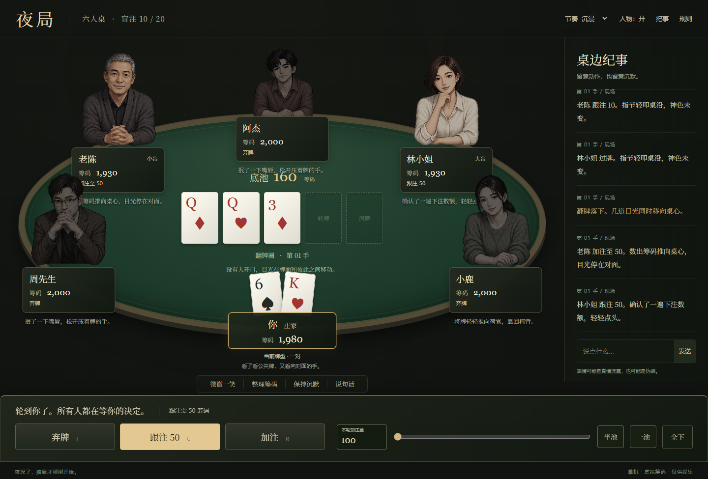

# 火星牌局 · Mars-3050

> **Alpha 验证版** · 当前可玩原型《夜局》 · 单机德州扑克 · 虚拟筹码

夜深了，六个人围坐在牌桌旁。有人轻轻敲着桌沿，有人把筹码重新码齐；一句话、一次停顿，都可能是试探，也可能只是伪装。你只有两张底牌，以及决定何时跟注、加注或离场的勇气。

《火星牌局》最终希望成为一款有角色、有氛围的牌桌游戏。现在的《夜局》是验证核心玩法与交互的 Alpha 版本：保留标准德州扑克的下注与结算规则，用人物姿态和文字纪事呈现牌桌上的紧张感。当前界面仍是夜间牌桌，火星主题会在后续迭代。



## 这一桌有什么

- **完整的一局**：你与五位电脑玩家各带 2,000 虚拟筹码入座，盲注 10 / 20；经过翻牌前、翻牌、转牌和河牌四轮下注，争夺主池与边池。
- **有性格的对手**：五位角色有不同的下注倾向。阿杰已有六种动作姿态；其他角色目前使用静态人物图。动作和桌边发言营造气氛，不是可靠的牌力提示。
- **用文字感受现场**：弃牌、推筹码、沉默和输赢反应写进桌边纪事。你也可以微笑、整理筹码、保持沉默，或说一句话；这些表达不会替你下注。
- **按自己的节奏玩**：轮到你时没有倒计时。可选沉浸、快速或慢速节奏，也能收起纪事、切换纯文字人物模式。
- **随时接着玩**：每手结算后自动保存筹码、庄位和手数；重新打开可从下一手继续。本次打开期间还能查看最近十手的文字回顾。

## 开始游戏

已在本机完成桌面构建时，Windows 可双击项目根目录的 `夜局.exe`，macOS 可双击 `夜局.app`。仓库目前提供源码，尚未上传可下载的安装包。克隆仓库后也可以直接打开 `src/index.html`，或运行：

```bash
npm start
```

然后访问 `http://127.0.0.1:5173/`。桌面开发使用 `npm run dev`。Windows 运行 `npm run build`，会将最新版 `夜局.exe` 复制到项目根目录；macOS 运行 `npm run build:mac`，会生成同时支持 Intel 与 Apple Silicon 的通用版，并将 `夜局.app` 复制到项目根目录。桌面构建需要 Rust、Tauri 和对应平台的系统构建工具。

Mac 首次构建通用版时，先安装两种 Rust 编译目标：

```bash
rustup target add aarch64-apple-darwin x86_64-apple-darwin
npm run build:mac
```

轮到你时可使用 **F** 弃牌、**C** 过牌或跟注、**R** 加注。加注可输入金额、拖动滑杆，或选半池/一池；全下需要再次确认。

也可以点击自己面前的筹码逐枚数好，再直接拖动桌前的筹码到公共牌或底池区域（也可使用底部投放按钮）。选中的筹码保持原位发光，并标注已选枚数，不会提前扣除；未选择时直接拖动一组筹码，会拿起其中一枚。选择的是**本次投入金额**，与「本轮加注至」不同；不满足跟注或最低加注时会保留选择并提示，拖到区外也不会扣款。点击「放回」可重新数。筹码按 500、100、25、5、1 面额显示，每组标有面额与真实枚数，总值与余额一致；余额变化后自动换零整理。下注和派彩使用对应金额的筹码动画，行动玩家有思考提示；轮到你时仍不限时。规则窗口提供牌型与选牌图示。

新公共牌让你击中顶对、超对、两对及更强牌型时，会出现文字冲击、金色扩散和最佳五张高亮。提示只使用你的底牌与已发公共牌，不代表已领先或获胜；同一牌面不会因其他玩家行动重复播放，弃牌后不再触发，并支持系统减少动态效果设置。

这是使用虚拟筹码的单机游戏，不含真人联网、账号或真钱交易。进行中的一手不会存档，退出后回到上一手结算状态；最近十手回顾目前也不会跨重启保存。

开发验证可运行 `npm test`。后续方向见 [优化计划](OPTIMIZATION_PLAN.md)，人物素材见 [图集说明](src/assets/README.md)。
